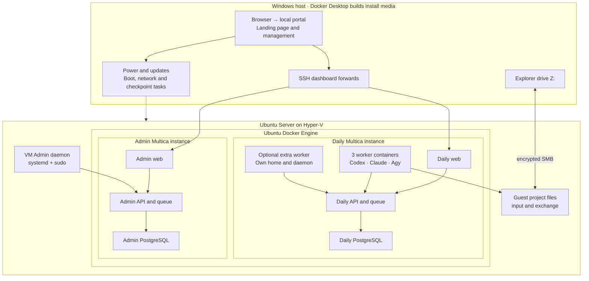

# Local Multica on Windows

The recommended installation runs stock Multica and its Codex, Claude and Agy
workers in an Ubuntu Hyper-V VM. You use the dashboard and project drive from
Windows. The repository also preserves the earlier native Windows installer.

This repository contains the installer, supervisor source, team settings and
coordination instructions. It includes summarized test findings and limitations.
It contains no provider credentials, database, session transcripts or old test
artifacts. It does not include the old approval broker or its source patches.

See [dependencies and upstream compatibility](docs/repository-guide.md#dependencies-and-upstream-compatibility)
for what we build locally, what comes from upstream, and what to retest
when a release changes.

## Install

Already running the Ubuntu VM? Run `./update-vm.ps1` to check for a Multica
release. See [update, restore and backup cleanup](docs/update-multica.md).

For isolated Linux workers, run `./install.ps1 -HyperV` from PowerShell 7.3+
and follow the [VM operating guide](hyperv/README.md). Open
[Multica dashboards](http://multica.localhost) from Windows and choose
**Manage installation** for power, boot startup and updates. The default
opens directly in any local browser. For a shared PC, add
`-RequireManagementKey` to the install command to require browser pairing.
Both pages stay up
while the guest is off. Existing installations can add the portal with
`./hyperv/Install-Portal.ps1`. To preview removal, run `./uninstall-vm.ps1`.
Both instances and the Ubuntu admin worker start on boot. Setup prints the dashboard links and
accounts, then asks which providers to sign in to. One sign-in per selected
provider connects its daily and admin workers. Press Enter to skip them
all, or run `./install.ps1 -HyperV -SkipProviderLogin` unattended. Run
`./hyperv/Connect-Guest.ps1 -Action QuickStart` to see them again.
The [VM admin provider and model](hyperv/README.md#vm-administrator) default
to Codex and `gpt-6-luna`. You can select Claude or Agy during setup or
switch the existing agent later.
See [dashboard credentials and multi-user setup](hyperv/README.md#dashboard-accounts)
for the defaults and how to change them. See the [Ubuntu upgrade
workflow](linux-guest/README.md) and [worker tools](linux-worker/README.md).

## What runs where

Windows hosts the landing page, **Manage installation**, and the tasks that
start and maintain the VM. Both Multica dashboards, both databases and all
workers run in Ubuntu. Windows Docker Desktop builds the Ubuntu install
media and can compile the portal if Go is unavailable. Once installed, the
deployment runs with Docker Desktop closed.



The VM can take jobs before Windows sign-in. At sign-in, user tasks start
the portal and dashboard forwards and reconnect the project drive. To stop,
start or restart the whole deployment, use **Manage installation** on the
Windows landing page. The portal stays available while Ubuntu is off. The
**VM Admin** dashboard is where you give an agent work inside Ubuntu.

Windows connects to files *stored in the VM*. From Explorer you can write
to both folders. Daily workers can read `/project/input` and can create,
edit or delete files in `/project/exchange`. Each worker has its own
provider home, container-local sudo and, by default, `/dev/kvm`. They have
no mount of the Windows filesystem, guest root or Docker socket. VM Admin
has sudo on Ubuntu and can read all those provider homes and change Docker.
Windows enforces the VM network rules, including the host and LAN blocks.
Public internet access is allowed, so treat anything a worker can read,
including its own login, as data it could send out. See the [VM isolation
and recovery notes](hyperv/README.md#boot-isolation-and-recovery).

## Give the team work

The daily dashboard starts with eight agents on three provider workers.
Give **Mika** an outcome. Mika delegates to **Code Lead** or **Research
Lead**. The leads can assign **Builder** or **Researcher** and ask
**Reviewer** to check the result. Those six roles share the Codex
container. **Claude Worker** and **Agy Flash Worker** use their respective
containers. You can also assign work directly. For a goal that should
keep moving while you're away, this command registers a recovery timer
before dispatching the first run:

```powershell
./new-goal.ps1 -HyperV -Title "Review the project" -OutcomeFile ./outcome.txt
```

Agents coordinate through stock Multica. The lead assigns child issues,
workers report results in the issue, and the lead can follow runs and wake
up to check progress. Use the daily dashboard to inspect a worker or send
a correction. The shared exchange is available for handing off files.
This works across provider containers through the daily API. Each provider
has its own Docker network. The admin instance has its own queue, database
and credentials, so assigning a daily issue cannot dispatch the Ubuntu
administrator.

To add an agent, select its runtime in the dashboard and set its model and
instructions. An agent using an API key on an existing provider runs in
that same worker, alongside any subscription-backed agents assigned to it.
A compatible endpoint may also need CLI-specific settings. A different CLI
needs an installed, registered runtime. Adding an agent or a key alone
doesn't provision a container. For a separate home or a custom executable,
use the [extra worker helper](docs/extra-workers.md). The same guide shows
how to register a Python gateway on either a daily worker or the Ubuntu
admin daemon. **Manage installation** lists agents from both workspaces,
their assigned runtimes and their current status. Agents sharing a worker also share its home
and filesystem permissions. Multica stores agent environment values,
including keys entered there, in its database in plaintext.

For installer defaults see [role instructions](config/roles.json),
[models and timers](config/settings.json) and the [coordination
instructions](coordination-local.txt). The VM guide covers [provider sign-in
and renewal](hyperv/README.md#sign-in-or-renew-a-provider-from-windows) and
[custom endpoints and keys](hyperv/README.md#other-model-endpoints-and-api-keys).
For Multica's own UI and CLI, look up agents, runtimes, issues and wakeups
in the upstream documentation. The [repository guide](docs/repository-guide.md)
indexes the installation, upgrade, recovery and testing notes.

## Earlier native Windows installation

The remaining setup and login instructions below apply to native Windows workers.

Start with these installed:

- Windows, PowerShell 7.2 or later, Git and Go 1.24 or later. Go's toolchain
  support downloads the upstream-required Go 1.26.9 when needed.
- Docker Desktop running Linux containers, with Docker Compose available.
- Native Codex CLI on PATH, signed in normally. If needed, run `codex login`.
  Provider sign-in is separate from signing in to the local Multica website.

Clone this repository or extract its ZIP, review
[config/settings.json](config/settings.json), then run:

```powershell
pwsh -NoProfile -File .\install.ps1
```

The shipped settings reproduce the selected models and local login address.
The address uses the reserved `.test` domain; no real mailbox is needed.
Use a different settings file with `-SettingsFile <path>` if necessary. Do not
put credentials in that file. The installer checks prerequisites; it does not
install Docker Desktop, change its startup preferences or reboot Windows.

The installer fetches upstream commit
`dbdbb299164347586e2650bb67684a490726a798`, builds the unchanged CLI and this
supervisor, and uses the tested v0.7.0 backend/web images pinned by digest.
It creates persistent Docker volumes, generates server secrets outside Git,
signs in through the normal local verification/PAT endpoints, creates the
workspace and six agents, and registers a task at sign-in and every minute.
No Multica source edits are applied. The locally compiled CLI reports `dev`;
the installation manifest records its source commit and binary hash.

The first fetch/build can take several minutes. Repeat installs keep the same
database, uploads, workspace, team IDs and secrets. They leave existing agent
instructions and custom arguments alone. The installer refuses to interrupt
active work or silently replace an existing installation. Interrupted fresh
workspace creation is recorded so setup can continue with the same settings.

## Browser login

Open [Local Work](http://localhost:43130/local-work/chat). On the login screen:

1. Enter `orchestration-trial@example.test` and request a code.
2. Enter `888888`. You do not need to receive an email.

The backend uses:

```dotenv
APP_ENV=development
MULTICA_DEV_VERIFICATION_CODE=888888
AUTH_TOKEN_TTL=87600h
```

The token lifetime is ten years on the server. The actual Edge browser test
capped its stored cookie at 400 days, so this does not promise ten years without
signing in again. Existing cookies also retain their earlier expiry until a
new login or renewal. See [Multica's auth documentation](https://multica.ai/docs/auth-setup)
and [Chrome's cookie limit](https://developer.chrome.com/blog/cookie-max-age-expires).

Both published ports bind only to `127.0.0.1`; PostgreSQL has no published port.
Anyone who can reach this instance and knows the address/code can sign in.
Do not expose this fixed-code configuration through a public port or tunnel.
The local CLI uses a separate, revocable 90-day PAT with Multica's normal
renewal support. Neither token is committed to this repository.

## Use and manage it

In Chat, use + to start a conversation with Mika. Give it an outcome and an
authorized project folder. Attach
the folder as a project resource. Project leads delegate to Builder or Researcher,
with Reviewer available for independent review. Decision roles use
`gpt-6.1-sol`/medium; workers use `gpt-6-luna`/low, one run per actor.

For an unattended goal with a backstop registered before its first dispatch:

```powershell
.\new-goal.ps1 -Title 'My outcome' -OutcomeFile .\outcome.txt -ProjectId '<project UUID>'
```

This creates the root in backlog, registers its finite timer and dispatches it.
The default is every ten minutes, up to 48 firings, expiring after eight hours.
This is a reconciliation schedule, not a spending limit or a guarantee of eight
hours of successful work. The chat instructions also tell Mika to create a
backstop; the helper makes registration explicit. Detailed test runs used
precreated backstops. See [operating notes](docs/operating-notes.md).

```powershell
.\manage.ps1 -Action Status
.\manage.ps1 -Action Backup
.\manage.ps1 -Action Stop
.\manage.ps1 -Action Start
```

Stop refuses active work. Backup writes a PostgreSQL archive, uploads archive and
private configuration copies; avoid editing uploads during the backup. A full
disaster restore has not been tested. Keep backups private.

The default installed locations are:

| Location | Contents |
| --- | --- |
| `~/.multica/local-ops` | Private `.env`, setup manifest, helpers, assets, source checkout, build cache, logs and backups |
| `~/.multica/stock-runtime/bin` | Stock CLI and GUI-subsystem supervisor executable |
| `~/.multica/workspaces-local` | Native agent work directories and session data |
| `~/.multica/profiles/orchestration-trial-20261024` | Normal Multica CLI profile and authentication |
| Docker volumes | PostgreSQL data and uploaded files; names recorded in the setup manifest |

The helpers are also copied into the runtime folder. Once installed, normal
operation does not depend on keeping this Git checkout in its original location.
Docker Desktop must be running. Physical reboot recovery after Windows sign-in
passed on the stock setup; this installation did not recover work before sign-in.
Automatic Multica CLI updates/reloads are disabled to keep the
tested version; upgrades require changing the pins and retesting. Codex can
update separately, so inspect effective policy after provider CLI upgrades.

## Existing installations

Do not run a second stack on the same ports. The migration command for the
existing trial is:

```powershell
pwsh -NoProfile -File .\install.ps1 -AdoptExisting -AdoptComposeProject orchestration-trial-multica -RenewLocalAuth
```

Adoption backs up the database, preserves the existing named data volumes and
JWT signing secret, recreates containers from this repo's configuration,
preserves team IDs/instructions, and replaces the idle native daemon. The renewal
switch uses a new ordinary local login and PAT; it does not copy provider
credentials. Review this mode before using it on a live install.

Adoption passed on a disposable stack and was then applied to the main deployment
with explicit approval on November 14, 2026. Its database, original data volumes,
six current agents and their settings were preserved. Browser login and the
workspace UI were verified afterward. The live Compose configuration and helpers
now live under `~/.multica/local-ops`, outside the original trial directory.
Keep any wanted historical project files before retiring the old trial folder.

## What remains custom

The Go supervisor is custom code. The PowerShell installer, management/goal
helpers and the role/coordination settings are also custom. They call stock
Multica's CLI/API and do not patch it. The separate fixed
[Office MCP tool](tools/office-fixture/README.md) is now bundled with portable
setup and tests. It is optional and is not enabled on the daily agents. No generic desktop or browser-control service is
installed. [The browser example](examples/browser-proof.mjs) is a diagnostic:
it passed outside a worker but failed during Edge startup inside the tested
native Codex sandbox. Do not treat it as a working in-worker browser integration.

## Findings, cleanup and development

- [Repository guide](docs/repository-guide.md): documentation map, what Git preserves,
  live paths and the tradeoffs from removing the fork.
- [Security posture](docs/security-posture.md): the distinct Codex, Agy and Claude
  boundaries; Claude's command sandbox requires WSL2/Linux on this Windows host.
- [Test summary](docs/findings.md): successes, failed attempts and coverage gaps.
- [Operating notes](docs/operating-notes.md): permissions, recovery, cost reporting,
  worktrees, browser automation and provider coverage in plain English.
- [Cleanup guide](docs/cleanup.md): what to keep and what previous tests left outside `tmp`.
- [Docker recovery and inventory](docs/docker-recovery-2026-11-20.md): the current
  three-container setup, identified leftovers and November 20 backup restoration.
- [Docker disk maintenance](docs/disk-maintenance.md): checked trim/compaction,
  failure recovery and automatic operation with or without Multica.
- [Adding tools](docs/tools.md): per-agent MCP configuration and the existing Office fixture.
- [Testing guide](docs/testing-guide.md): repeatable checks, fixtures and evidence limits.
- [Historical notes](docs/history/README.md): 29 preserved comparison, setup and test reports.

```powershell
go test ./...
go vet ./...
node --test ./tests/office-fixture.test.mjs
pwsh -NoProfile -File .\tests\installer.tests.ps1 -Docker
pwsh -NoProfile -File .\tests\disk-maintenance.tests.ps1
```

CI checks this repository's code on Windows. It does not certify the full upstream
Multica test suite, which has recorded Windows failures. Fresh-install testing
used an existing Windows machine with prerequisites already installed, not a
new Windows VM. Nothing in this project pushes changes upstream automatically.
